<div align="center">
  
  <h1>Foxycape PDF</h1>
</div>

Obsidian 向けの PDF リーダーです。ハイライト、引用、ディープリンクから原文の位置に戻れ、ノートの流れが途切れません。論文や学習資料を読むとき、翻訳、単語調べ、解説、質問は、開いている PDF の中で完結します。

[English](README.md) | [العربية](README.ar.md) | [Deutsch](README.de.md) | [Español](README.es.md) | [Français](README.fr.md) | [Bahasa Indonesia](README.id.md) | [Italiano](README.it.md) | [日本語](README.ja.md) | [한국어](README.ko.md) | [Nederlands](README.nl.md) | [Polski](README.pl.md) | [Português](README.pt.md) | [Português (Brasil)](README.pt-BR.md) | [Русский](README.ru.md) | [ไทย](README.th.md) | [Türkçe](README.tr.md) | [Українська](README.uk.md) | [Tiếng Việt](README.vi.md) | [中文](README.zh.md) | [繁體中文](README.zh-TW.md)

## なぜ必要か

Obsidian で PDF を読むと、ノートまでの流れが切れがちです。

- ハイライトは PDF に残り、保管庫のノートは別の場所にある。
- 図がほしいときはスクリーンショットになり、ぼやけて扱いづらい。
- 貼った引用や画像が、ページや範囲まで戻らない。
- ダークテーマでは、明るい PDF のページがまぶしい。
- リーダーを替えると、すでにあるページ番号や選択範囲のリンクが壊れることがある。

論文や学習資料では、知らない語、長い文、見慣れない概念で読みが止まります。翻訳、辞書、質問は別の道具に移り、ページは自分で合わせることになります。

Foxycape PDF は、これらの欠けを Obsidian の中で埋めます。

## 機能

### 今開いているページで、論文や学習資料を読み解く

#### 外国語の論文を、拾い読みから読み込みへ

範囲を選ぶとその場で翻訳でき、まず大意がわかります。標準は Microsoft の翻訳で、流し読みに AI 利用量はかかりません。専門的な言い回しに近づけたいときは AI に切り替え、**速度優先**と**品質優先**を選べ、訳先の言語も指定できます。

その段落でまだ曖昧な語があれば、**単語を調べる**を使います。発音は IPA、ピンイン、または仮名で示し、この段落での意味も一緒に出ます。文全体を選んだときは、先に文の意味、そのあと難しい語です。

まだ読み解けなければ、**この箇所を解説**でその段落だけをほどき、先を読み続けられます。**簡潔**なら一、二文でページをめくれます。広げたいときは解説の**詳細**です。さらに尋ねるときは、結果のあとの**詳細**から、原文とすでにある解説がサイドバーの**AI に質問**に渡ります。

訳文、解説、単語調べはこの PDF の一覧に残り、あとから絞り込み、そのページへ戻れます。ノートに残すときは、設定で種類ごとに書き込みをオンにします（初期状態ではオフ）。PDF と同名の Markdown に追記されます。

<!-- GIF: docs/gifs/read-in-place.gif — 選択して翻訳、単語調べ、解説 -->

#### 長い資料を読みながら尋ねる

範囲を選んですぐ**AI に質問**できます。質問にはその原文が付きます。文書が長いときは、先にこの文書を分析するかどうかを尋ねます。同意すると、回答は文書中の段落に沿い、引用からそのページを開けます。同意しない場合は、一般的な知識にもとづいて答えます。あとからメニューの**この本を分析**も選べます。

引用からページに戻ったあと、その段落がまだわからなければ、翻訳、単語調べ、解説を続けて使えます。回答のあとには、続けて押せる関連質問が出ます。会話はこの PDF に保存され、次回も検索でき、新しく始めることもできます。

<!-- GIF: docs/gifs/ask-while-reading.gif — 開いている PDF に質問し、引用からページへ戻る -->

### モデルと利用量

解説、単語調べ、AI 翻訳、AI への質問は、選択中のモデルを使います。公式モデルの消費はライセンスの AI 利用量に計上されます。自分の**ベース URL** と **API キー**も指定できます。Microsoft の翻訳はこの利用量を使いません。ライセンスは無料で受け取れ、利用量は購入するか、共有して得られます。

### ハイライトをノートへ

ハイライトを PDF の中だけに置いておく必要はありません。新しいハイライトは、PDF と同名の Markdown ノートを作るか更新し、戻りリンク付きの抜粋を追記します。そのノートを分割して開くこともできます。不要なら設定で消せます。

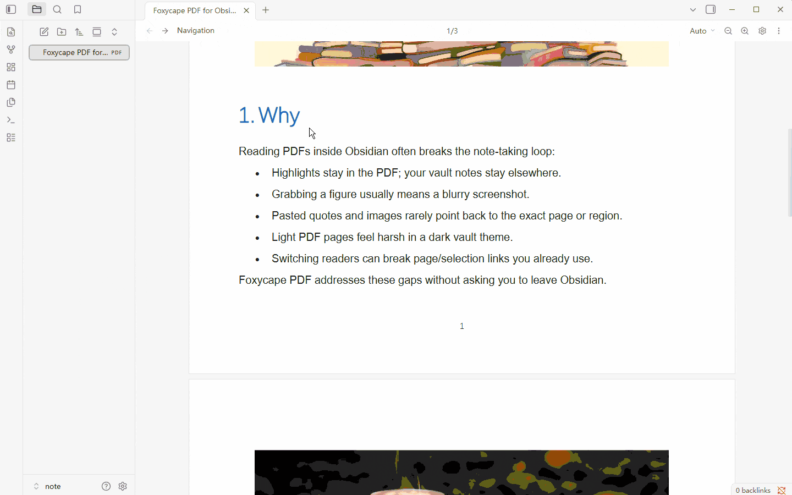
<!-- GIF: docs/gifs/highlight-notes.gif — ハイライトが同名ノートへ書き込まれる -->

### 埋め込み画像を原寸で取り出す

ぼやけたスクリーンショットで済ませなくて済みます。埋め込み画像にホバーする（モバイルではタッチ操作）と、プレビュー、コピー、元画像のダウンロードができます。

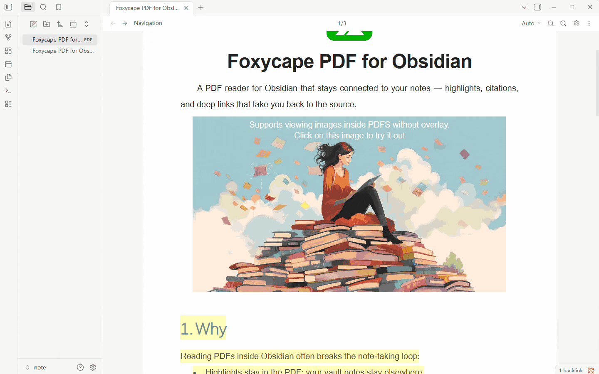
<!-- GIF: docs/gifs/embed-images.gif — ホバーしてプレビュー、コピー、ダウンロード -->

### テキストと画像の引用から、原文へ戻る

引用には出所が付き、あとからノートから PDF へ戻れます。

- テキスト引用を、ディープリンク付き Markdown としてコピーする（`#page=` / `#selection=` / `#markId=`）。
- 画像引用をコピーする。Markdown に貼ると PNG が PDF の隣に保存され、クリックできるリンクが入る。
- ノート内の画像を右クリック → **Foxycape で開く**。対応するページに戻り、元の範囲が強調される。

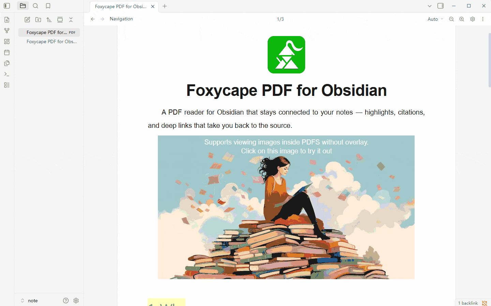
<!-- GIF: docs/gifs/cite-and-back.gif — 引用をコピー → 貼り付け → PDF に戻る -->

### Obsidian のテーマに合わせる

ダークな保管庫では、明るい PDF のページがまぶしくなりがちです。グレースケールのベクター色を、テーマの前景色と背景色へ割り当てられます（BETA）。対象はすべて、ダークのみ、ライトのみから選べます。カラーの図とカラーのベクターはそのままです。

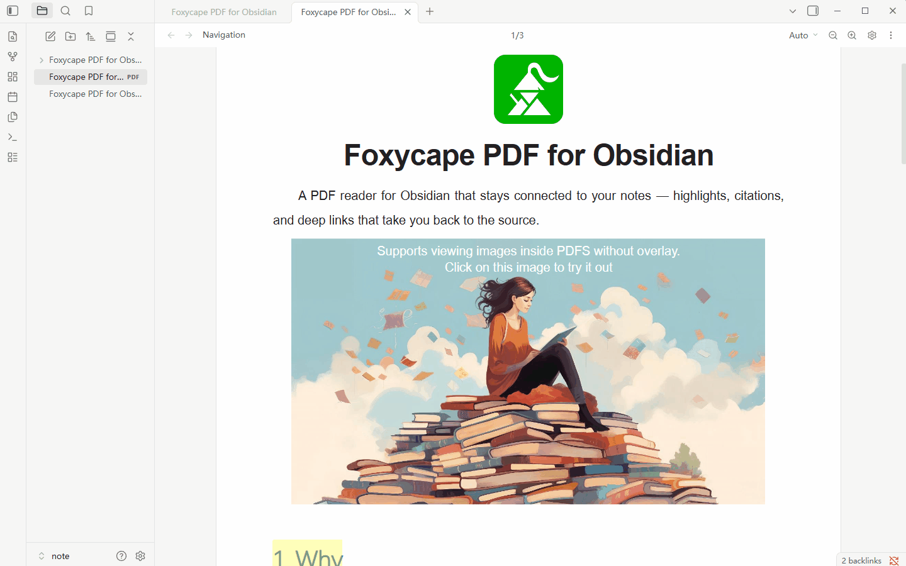

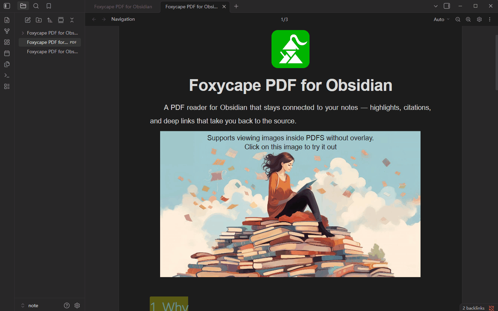
<!-- GIF: docs/gifs/theme-adapt.gif — PDF のページがテーマに従う -->

### 範囲を指定して撮る

OS のスクリーンショットに切り替えたり、ページをまたいで自分でつなぐ必要はありません。ツールバーの**スクリーンショット**を押し、PDF 上で範囲をドラッグします。画像をコピーするか、画像引用をコピーします。ノートに貼ったあと、右クリックで元の位置へ戻れます。

1 ページの範囲を切り出します。

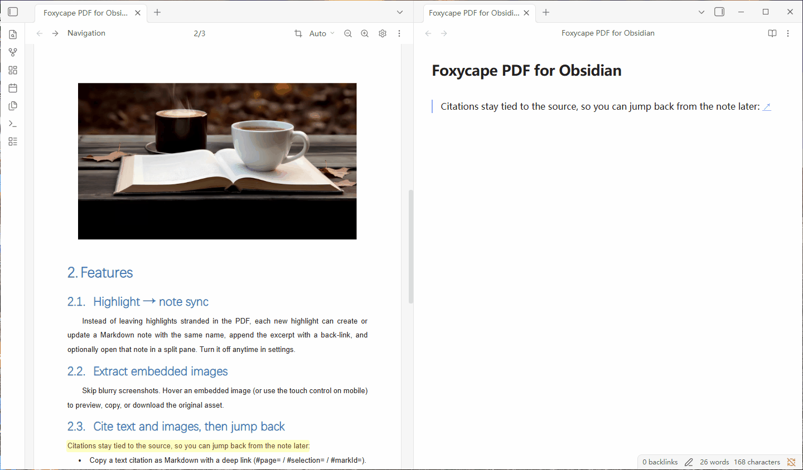
<!-- GIF: docs/gifs/screenshot-single.gif — 単一ページの範囲指定 -->

範囲がページの境をまたぐと、一続きの画像に自動でつながります。

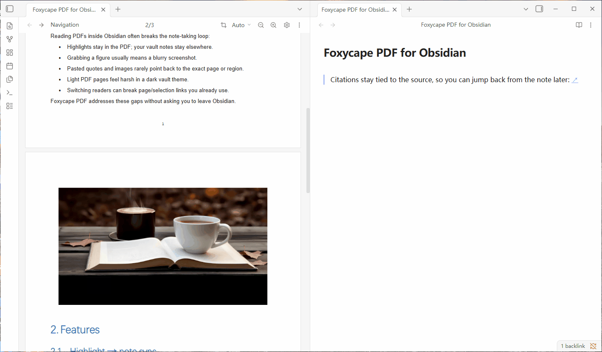
<!-- GIF: docs/gifs/screenshot-multi.gif — 複数ページを一枚につなぐ -->

### 組み込みリーダーの位置とリンク

リーダーを替えても、すでにあるリンクは壊れるべきではありません。Obsidian の `#page=` と `#selection=` を解釈し、既定の PDF リーダーにできます。開いているタブがあればそれを使い、`#markId=` でハイライトの位置へ正確に飛びます。

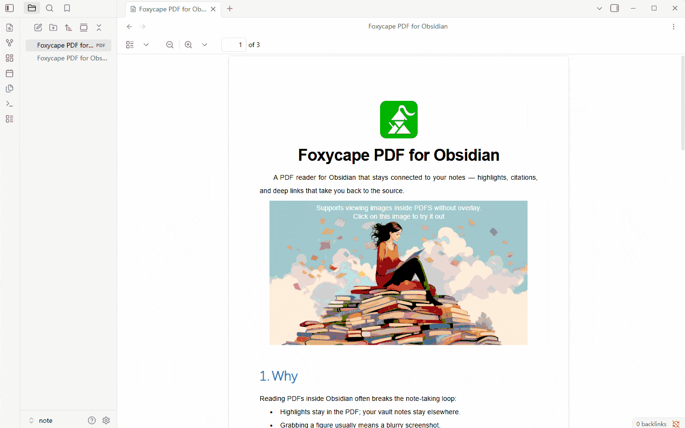
<!-- GIF: docs/gifs/compat-links.gif — 既存のページ番号・選択範囲リンクを開く -->

### ハイライトのスタイルと一覧

蛍光ペン、波線、直線の下線と、自分で選んだ色に対応します。一覧では絞り込み、並べ替え、移動、削除ができます。

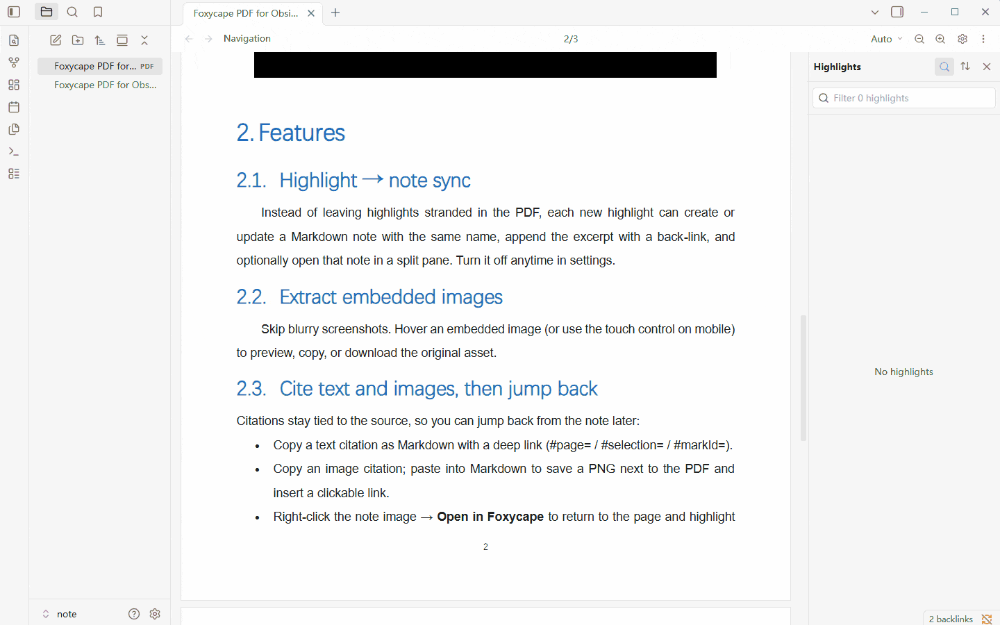
<!-- GIF: docs/gifs/annotations.gif — スタイルとハイライト一覧 -->

### スマートコピー — 途中の改行を外す

PDF の組版は、文の途中で行を切ることが多く、コピーすると不要な改行が残ります。いつもどおり選択してコピーすれば、Foxycape がそのソフト改行を外し、つながった段落として貼り付けられます。本当の段落区切りは残ります。

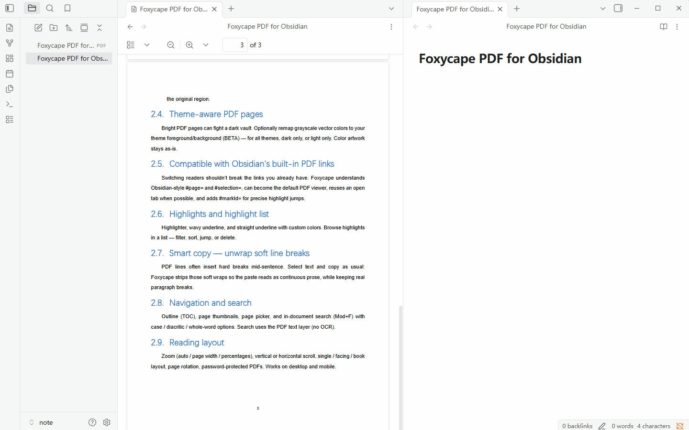
<!-- GIF: docs/gifs/smart-copy.gif — 選択 → コピー → 文中の改行なしで貼り付け -->

### 移動と検索

目次、サムネイル、ページ移動、文書内検索（`Mod+F`）。大文字小文字、発音区別符、単語全体を区別できます。検索は PDF のテキストレイヤーを使い、OCR はありません。

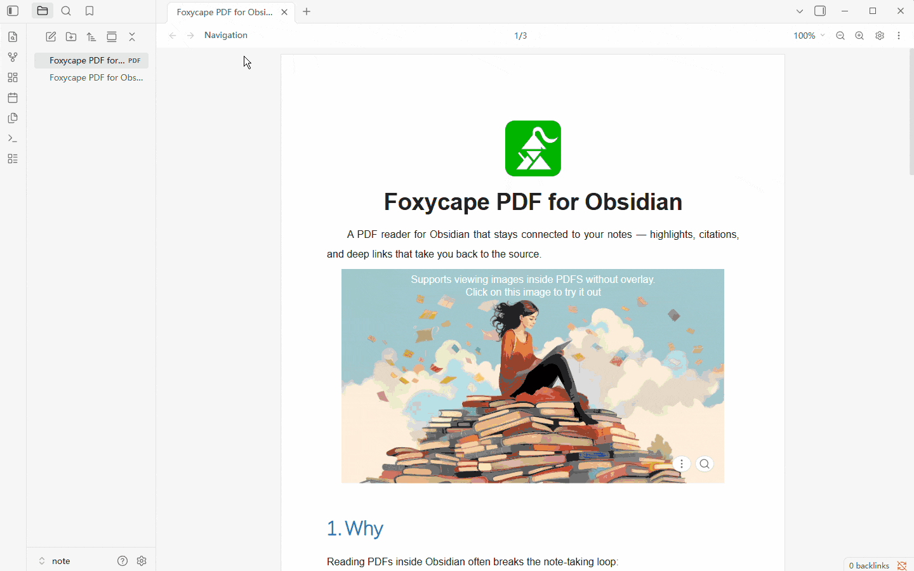
<!-- GIF: docs/gifs/navigate-search.gif — 目次、サムネイル、検索 -->

### 読み方のレイアウト

拡大（自動 / ページ幅 / パーセント）、縦または横スクロール、単ページ / 見開き / 書籍、ページの回転、パスワード付き PDF。デスクトップとモバイルの両方で使えます。

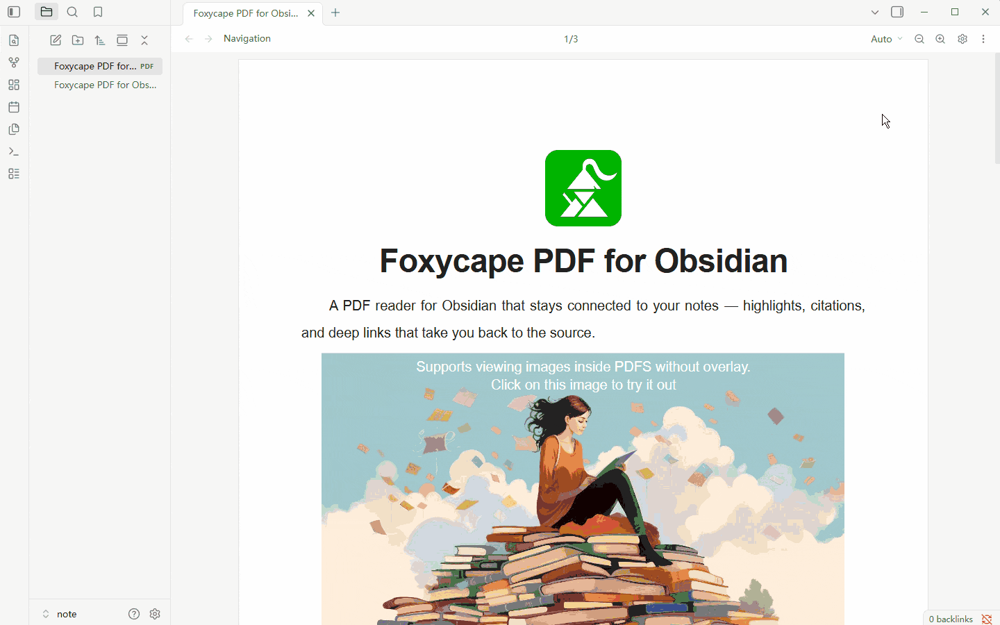

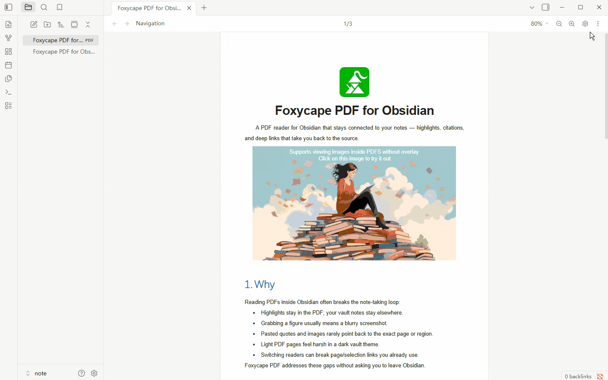
<!-- GIF: docs/gifs/layout.gif — レイアウトと拡大 -->

### 既定の PDF リーダーにする

設定で**デフォルト PDF ビューアとして使用**をオンにすると、Obsidian は PDF を Foxycape で開きます。ディープリンク、ハイライト、テーマへの追従まで一通り使えます。

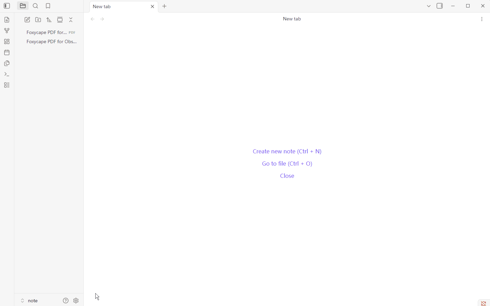
<!-- GIF: docs/gifs/set-default.gif — 設定で既定の PDF ビューアを有効にする -->

## 開発

```bash
npm install
npm run build      # → dist/main.js、styles.css、manifest.json、versions.json、markdown.js、pdfjs.zip、reader-bundle.zip、locales.zip、pdfjs-assets.zip
npm run dev        # ウォッチビルド。OBSIDIAN_PLUGIN_DIR があれば成功のたびにそのプラグインフォルダへコピー
npm test
npm run typecheck
npm run link       # dist/ を保管庫の .obsidian/plugins/foxycape-pdf へ junction する
```

`.env` に `OBSIDIAN_PLUGIN_DIR` を書くと（`.env.example` を参照）、`npm run dev` はビルドが成功するたびに成果物をそこへコピーします。`npm run link` も同じ変数を読み、未設定なら既定の保管庫パスに戻ります。プロセスの環境変数がファイルより優先されます。

## ライセンス

このリポジトリは **source available** です。適用されるのは [Foxycape Plugins License Agreement](LICENSE.md) です。

- 使用、改変、再配布はできます。ただし、Foxycape の商用製品と競合する、不特定多数向けの Obsidian（または同類のノートアプリ）向け汎用製品にすることは制限されます。試用やライセンス確認を外した無料の公開掲載も含まれます。
- 私的な使用、単一の組織内での使用、特定顧客向けの個別開発は、この制限の対象外です。
- この契約を超える権利が必要なときは、**company@tiefeiying.com** まで連絡してください。

PDF.js などの第三者コンポーネントと、別に公開されているパッケージ（MIT の `@foxycape/core` など）は、それぞれのライセンスに従います。

全文は [LICENSE.md](LICENSE.md) を参照してください。
